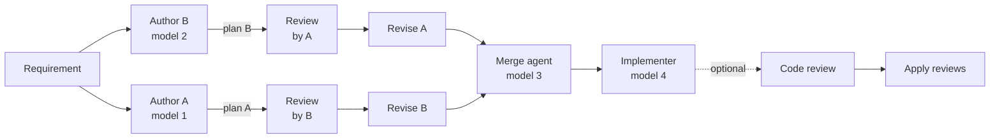
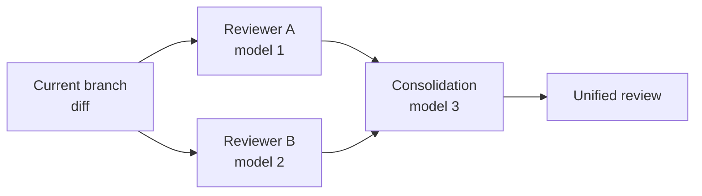

<p align="center">
  
</p>

<h1 align="center">F5</h1>

<p align="center">
  A desktop and web workspace for coding agents, where each step of a workflow can run on a different provider and model.
</p>

F5 runs Codex, Claude Code, Cursor, OpenCode, Grok, Antigravity, Muse Code and custom ACP agents against your
repositories, and chains them into multi-model workflows: competing plans, cross-reviews, merges,
implementation and code review, with every step on the provider and model you pick.

> [!WARNING]
> This project is very early. Expect bugs, breaking changes and rough edges. These docs track the current source checkout, so the latest packaged release may lag behind them.


<p align="center">
  
</p>

<table>
  <tr>
    <td width="50%"></td>
    <td width="50%"></td>
  </tr>
  <tr>
    <td align="center"><em>Home: what needs you, what is running, and recent work.</em></td>
    <td align="center"><em>A thread with its file changes open in the Diff panel.</em></td>
  </tr>
</table>

## Download

[Download F5](https://github.com/lopes-felipe/f5/releases/latest). Windows x64 is the first stable
desktop platform; macOS has an Apple Silicon preview, and the `f5` CLI ships for every platform.
See [Install F5](docs/install.md), then [Getting started](docs/user/getting-started.md).

## What you can do

- **Run multi-model workflows** for features, code review, investigations and documents → [Workflows](docs/user/workflows.md)
- **Work in threads** with diffs, checkpoints, terminals and a next-turn queue → [Threads and workspaces](docs/user/threads-and-workspaces.md)
- **Use seven providers**, several accounts each → [Provider prerequisites](docs/provider-prerequisites.md)
- **Choose how much agents may do** per thread → [Runtime modes](docs/runtime-modes.md)
- **Send one message to several models**, each in its own worktree → [Worktrees](docs/user/worktrees-and-storage-automation.md)
- **Review pull requests** from GitHub, GitLab, Bitbucket, Azure DevOps and Forgejo → [PR Hub](docs/user/pr-hub-forges.md)
- **Track tokens, cost and account limits** → [Usage and limits](docs/user/usage-limits.md)
- **Give agents MCP servers, skills and memory** → [Agent tools](docs/user/agent-tools.md)

## Multi-model workflows

**Feature.** Two authors plan, review each other and revise; a merge agent combines the plans, and
an implementer builds the result when you ask.



**Code Review.** Two reviewers inspect a branch independently, and a consolidation agent merges
their findings into one ranked report.



Investigation and Document workflows, options and retries: [Workflows](docs/user/workflows.md).

## Build from source

Requires [Bun](https://bun.sh/) ≥ 1.3.9, [Node.js](https://nodejs.org/) ≥ 24.13.1 and Git.

```bash
bun install --frozen-lockfile
bun run build:desktop
bun run start:desktop
```

More recipes, including packaging and updating a checkout: [Quick start](docs/quick-start.md).

## Documentation

Guides, configuration and contributor docs: **[docs/README.md](docs/README.md)**.

## Relationship to upstream

F5 is an opinionated fork of [T3 Code](https://github.com/pingdotgg/t3code) by [@pingdotgg](https://github.com/pingdotgg). It keeps the upstream's MIT license and some legacy identifiers (the `t3` npm package, `@t3tools/*` workspace names, `T3CODE_*` environment variables) so existing installations keep working. See [`NOTICE.md`](./NOTICE.md) and [`CHANGELOG.md`](./CHANGELOG.md).

## Community

Need help or want to follow along? Join the [Discord](https://discord.gg/jn4EGJjrvv).

## Contributing

We are not actively accepting contributions. Small, focused bug fixes and reliability improvements are most likely to be reviewed. Details in [`CONTRIBUTING.md`](./CONTRIBUTING.md).

## License

[MIT](./LICENSE)
