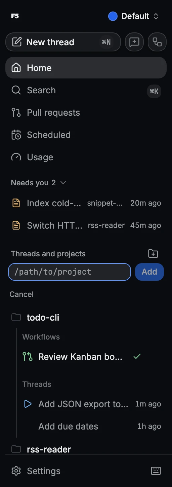

# Getting started

Add a project, pick a model, and have an agent make its first change. This takes about five
minutes once F5 is installed.

## Before you start

- [Install F5](../install.md).
- Install Git.
- Sign in to at least one provider, such as `codex login` for [Codex](../providers/codex.md) or
  `claude auth login` for [Claude Code](../providers/claude.md). All seven are listed in
  [Provider prerequisites](../provider-prerequisites.md).

## How to

1. Click **Add project** (the folder icon next to **Projects** in the sidebar), enter the
   project's folder path, and click **Add**.
2. Click **New thread** (`mod+N`).
3. Pick a provider and model in the composer.
4. Choose an access mode.
5. Describe the change and send it.
6. Review the changes the agent made.

## Pick a model

The model picker lists every signed-in provider with its models. Star a model to keep it at the
top. The chip next to the picker sets the reasoning effort. You can switch models between messages
in the same thread.

## Choose how much the agent may do

**Supervised** asks before edits and commands. **Full access**, the default, runs without prompts.
The two modes in between are described in [Runtime modes](../runtime-modes.md). The workspace
switch under the composer can run the thread in its own Git worktree, so your checkout stays
untouched.

## Review changes

Each edit shows up in the timeline as a file-change card with its diff. **Changed files** at the
end of a turn sums up everything that turn changed, and **View full diff** opens the whole patch.

## Good to know

- F5 names new threads automatically and can refine the name after the first and third turns.
  Renaming a thread yourself stops this.
- **Needs you** on Home and in the sidebar lists threads waiting for an approval or answer.
- `mod+K` searches threads, workflows and commands.
- Drop files onto the composer to attach them. See [Attachments and media](attachments-and-media.md).

If the desktop server repeatedly fails to start, F5 opens a **could not start** window with
the reason and recent server output. Use **Update** when a newer build is available, or
**Download** to reinstall the last version that started successfully. **Copy details** includes
the diagnostic and log directory for a bug report. **Retry** restarts the profile's server.
The previous version is saved only after the server stays healthy for a minute.

For verbose Cursor and Grok ACP wire diagnostics, start the server with
`F5_ACP_PROTOCOL_LOGGING=1`. Protocol logging is off by default; request diagnostics remain enabled.

## Related

- [Threads and workspaces](threads-and-workspaces.md): the composer, queue, panels and Git
- [Workflows](workflows.md): run several models on one task
- [Worktrees and storage automation](worktrees-and-storage-automation.md)
- [Keybindings](../../KEYBINDINGS.md)
