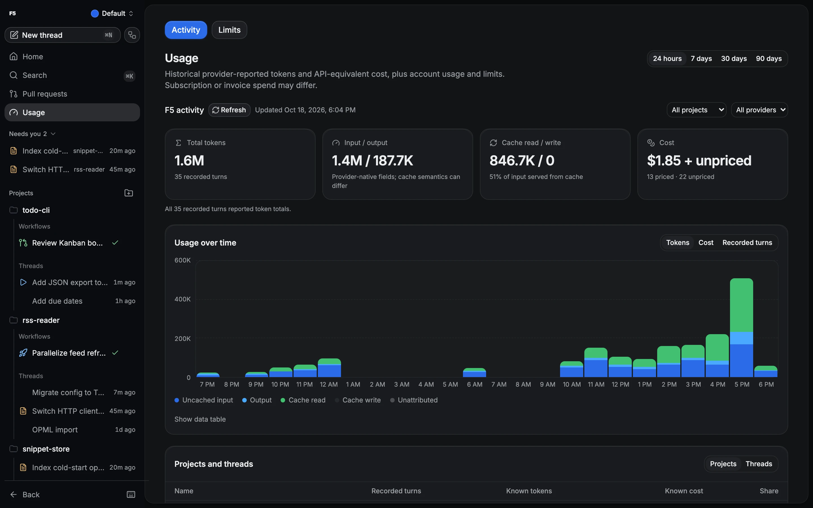
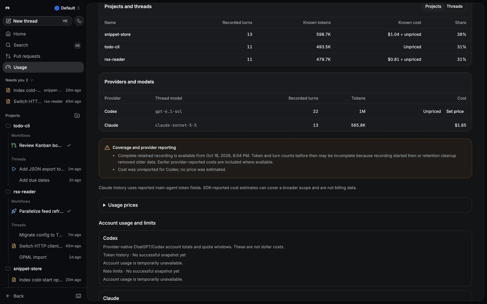
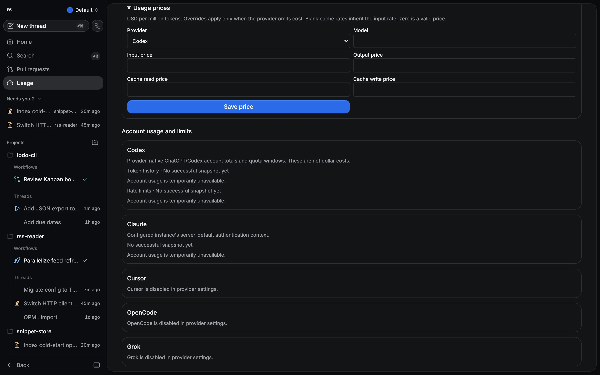

# Usage and limits

The Usage page shows two things. **Activity** covers the tokens, cost and turns F5 recorded,
plus local Muse Code model-call history.
**Limits** shows how much of each account's allowance is left.

## How to

1. Open **Usage** from the sidebar or the command palette, or press `mod+U` outside the terminal
   (`usage.open` in **Settings → Keybindings**). Type `/usage-limits` in the composer for a quick
   read.
2. Choose **Activity** or **Limits**.
3. Pick a range (**24h**, **7d**, **30d**, **90d**) and, optionally, a project. The provider menu
   next to the tabs limits both tabs to the providers you check, and F5 remembers that choice.
4. Switch the chart between tokens, cost and turns.

On Usage, when you are not typing in a field, press `T`, `C` or `R` for tokens, cost or recorded
turns, `L` for Limits, and `1` to `4` for 24 hours, 7, 30 or 90 days. `Escape` returns to the
previous page. Rebind them under **Usage** in **Settings → Keybindings**; they use the
`usagePageOpen` context.

The URL keeps the tab, range and filters, so you can bookmark a view or share it.

> [!NOTE]
> These are different numbers. Activity counts turns F5 ran and local Muse Code model calls. Account limits come from the
> provider and include use outside F5. Cost is an estimate from token prices; your actual bill is
> the provider's invoice, which F5 never sees.

## Activity

Activity counts completed F5 turns and native Muse Code history, including CLI sessions run outside F5.
Other providers' external CLI sessions are not included. Native model calls do not increase recorded turn counts. Metric
cards compare each value with the previous period of the same length and show how much input was
served from cache.

**Usage over time** has a bar per interval. Hover a bar for details, or click it to pin it.
**Show data table** lists every interval.

## Projects and threads

This table ranks projects and their top threads by the chart metric. Choose a project to filter
the page; thread names link to their chat. Deleted projects and threads still count and are
labeled as deleted.

## Usage prices

Costs are API-equivalent estimates and can differ from your subscription or invoice. Where a
provider reports no cost, set a price in **Usage prices** (USD per million tokens) for that
provider and model. **Set price** next to an unpriced model opens the editor with that model
filled in. Provider-reported costs, including zero, always win.

To count one model as another, such as a preview model under its released name, add it under
**Model mappings** with the target model ID in **Map to**. The mapped model no longer appears on
Usage: its tokens and cost move to the target and use the target's price. Remove the mapping to
show the model on its own again.

## Limits

Each account gets meters showing the allowance left, when it resets and when it was last read.
Once a meter has enough recent samples, it shows a sparkline and a forecast at your current pace.
**Refresh limits** forces a new read. Codex's main allowance and Spark windows are shown
separately; using a reset credit asks you to confirm first.

## Good to know

- After a restart, the Limits tab shows each account's last snapshot, labeled **Last known before
  restart**, until a fresh read succeeds.
- Turn off **Settings → Threads → Sample account limits in the background** to read limits only
  while the page is open.
- Accounts are never merged by email or display name.
- `/usage-limits` reads the cached snapshot. It never sends a turn or refreshes an account.

> [!NOTE]
> The Limits screenshots are omitted because meters come from live accounts.

Details and limits

**URL parameters.** `tab` (`activity`, `limits`), `range` (`24h`, `7d`, `30d`, `90d`),
`projectId` and `metric` (`tokens`, `cost`, `turns`). F5 remembers the last tab and range. The
default `tokens` metric is left out of the URL. The provider filter is a saved setting, not a URL
parameter; F5 drops the older `provider` parameter.

**Refresh timing**

| Trigger                        | Behavior                                                                                             |
| ------------------------------ | ---------------------------------------------------------------------------------------------------- |
| Open Usage page                | Re-reads every 5 minutes and on focus or reconnect; reuses snapshots under 5 minutes old             |
| Background sampling            | 1 minute after startup, then every 10 minutes while a window resets within 6 hours, otherwise hourly |
| Failed reads                   | Back off per account: 10, 20, 40 … up to 120 minutes (includes logged-out accounts)                  |
| Read deadline                  | 2 minutes                                                                                            |
| `/usage-limits` staleness note | Adds "(as of …)" when the snapshot is over 15 minutes old                                            |

**Retention and identity.** Quota samples are kept for 35 days. Snapshots of removed instances
expire after 35 days. An account's identity comes from its binary, home and credential settings,
so changing those starts a new history. A configured CLIProxy account ID keeps history when you
rotate the hub key; rotating a raw API key starts new history. Switching OAuth logins inside the
same home is not detected. Identities are stored as keyed hashes.

**Forecasts** need at least 15 minutes of recent samples and a snapshot under 30 minutes old.

**Reset credits.** One redemption runs at a time per instance, with a 30-second deadline. If the
outcome is uncertain, a retry reuses the original key, even after a reload or restart.

**Token coverage.** A field no turn reported shows "Unreported". A partly reported field shows "N
of M recorded turns". Older cost-only history counts as legacy cost records. Cost recorded before
per-project attribution appears as "Usage without a project". Blank cache prices inherit the
input price, and zero is a valid price.

Muse Code also includes local native session history (including child sessions and automated
reviews) from the home reported by the configured CLI, using that account's environment.
Sessions recorded by F5 use durable per-turn native identities for deduplication; external
sessions appear under **Usage without a project**. Copied inference envelopes count once.
Native model calls contribute tokens and pricing without increasing the recorded turn count.
Unknown models remain unpriced until you configure a custom price.
The date and provider filters apply to native history. Project-filtered summaries do not scan
external history, and disabled instances never launch Muse for Usage.
History refreshes in the background when Usage is requested. Unchanged files are reused and
only appended complete lines are parsed. Instances sharing a native home share one incremental
reader. A refresh notice appears while it runs; failures retain the last successful snapshot,
report the failed phase, and retry with increasing backoff up to ten minutes.

Purging an F5 thread does not delete the separate Muse CLI history. If those native files
remain on disk, their usage can appear under **Usage without a project** after a refresh.
Removing the corresponding native session history stops that external contribution.
Older facts with no retained native identity or terminal receipt cannot be matched safely
to CLI sessions. Their overlapping native history may count twice; F5 does not guess an
identity and discard unrelated CLI activity.

**Other providers**

| Provider    | Supported credentials                                                                                                           |
| ----------- | ------------------------------------------------------------------------------------------------------------------------------- |
| Cursor      | Explicit token, `CURSOR_API_KEY` (default Cursor endpoint only), or file-based login. Keychain-only credentials are unavailable |
| Grok        | Standard subscription login or a selected xAI account on a CLIProxyAPI hub                                                      |
| OpenCode Go | Local API credentials. Externally managed servers are not probed                                                                |

For a Grok hub account, set `F5_CLIPROXY_HUB_URL`, `F5_CLIPROXY_ACCOUNT_ID` and a sensitive
`F5_CLIPROXY_API_KEY` in the instance environment. The hub URL can include a path prefix or point
to its panel, such as `https://hub.example/cliproxy/management.html`. F5 appends
`/v0/management` when it requests account usage. The management key goes only to the configured
hub, and redirects are refused.

**Antigravity** limits are off by default. F5 never calls Google's quota APIs or reads them
through CLIProxyAPI, because Google warned that those direct calls can get an account flagged. To
see the Gemini and Claude & GPT 5-hour and weekly limits, turn on **Read limits with the
Antigravity CLI** for the instance in **Settings → Providers**. F5 then runs the CLI's own
`/usage` command with that instance's sign-in: when Usage refreshes, at most once a minute, and
on the background quota sampler's schedule (every 10 minutes while a 5-hour window is close to
resetting, otherwise hourly). The command needs Antigravity 1.5.15 or newer. If a version answers
`/usage` with a model turn, F5 stops asking on that version.

Whether or not reads are on, a turn that stops on an exhausted Antigravity quota shows "Quota
reached during a turn" and its reset time on the card. F5 takes that from the turn itself, so it
asks Google nothing. An instance that signs in with a Gemini API key shows "Billed per token".

## Related

- [Claude](../providers/claude.md) and [Codex](../providers/codex.md) account setup
- [Getting started](getting-started.md)
- [Antigravity](../providers/antigravity.md)
