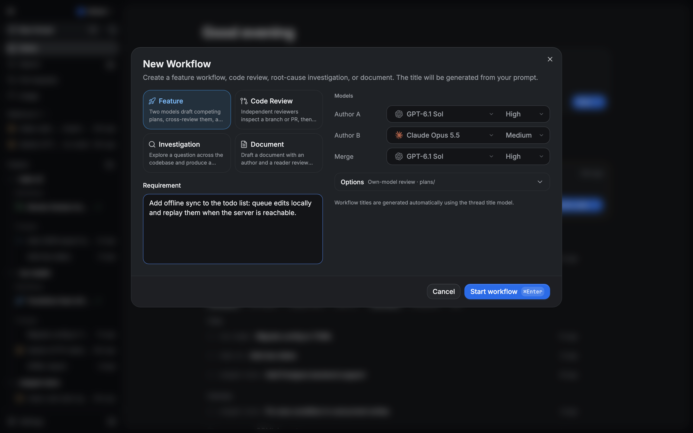
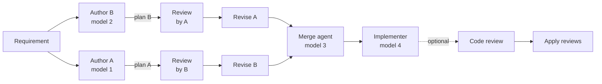
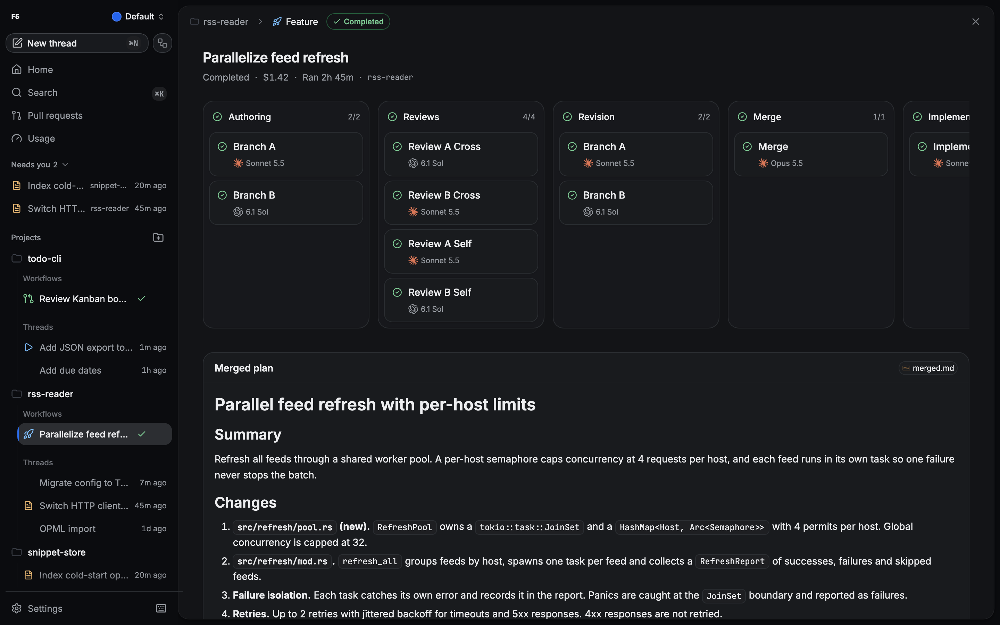
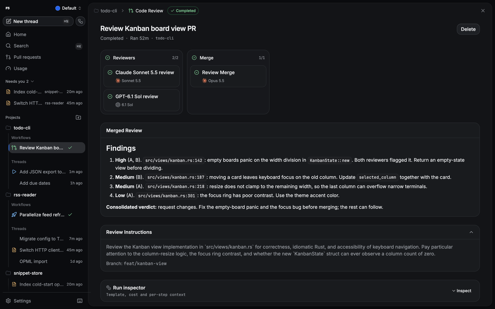

# Workflows

A workflow runs one piece of work through several agents, each on the provider, model and
reasoning effort you pick for its slot. F5 creates a thread for every stage, so you can open any
step and read exactly what that agent did.

## How to

1. Click **New workflow** in the sidebar or on Home, or press `mod+shift+n`.
2. Pick a type: **Feature**, **Code Review**, **Investigation** or **Document**.
3. Describe the work. Attached files are added to the prompt as paths.
4. Under **Models**, choose a provider, model and reasoning effort for each slot. Click **Add
   author**, **Add reviewer** or **Add investigator** for more actors, and the remove button on a
   row from C on to drop it.
5. Open **Options** if needed, then click **Start workflow** (`mod+enter`).

The run belongs to the project selected on Home or in the sidebar, and F5 generates its title.

## The four types

| Type          | Stages                                                                                             | Slots                                     |
| ------------- | -------------------------------------------------------------------------------------------------- | ----------------------------------------- |
| Feature       | Competing plans, cross-reviews, revisions and a merge; implementation when you ask                 | Author A, Author B, Merge                 |
| Code Review   | Independent reviews of a branch or PR, consolidated into one ranked report                         | Reviewer A, Reviewer B, Consolidation     |
| Investigation | Independent investigations, cross-review, optional self-review, then a synthesis                   | Investigator A, Investigator B, Synthesis |
| Document      | Competing drafts (RFC, ADR, PRD, runbook and more), reviews, a merge and an optional reader review | Author A, Author B, Merge, Reader         |

## More than two actors

Every type starts with two actors. Add more as rows in the dialog:

| Type          | Actors        | Maximum |
| ------------- | ------------- | ------- |
| Feature       | Authors       | 4       |
| Document      | Authors       | 4       |
| Investigation | Investigators | 4       |
| Code Review   | Reviewers     | 6       |

- **Cross-review is a full mesh.** With more than two authors or investigators, each one reviews
  every other one's output. Three authors with own-model review run 3 drafts, 6 cross-reviews,
  3 own-model reviews, 3 revisions and 1 merge; four authors run 25 turns. The dialog shows the
  count under the rows once there are three or more.
- At most 4 review turns run at a time; the rest wait their turn and start as others finish.
- Document authors and investigators must all use different provider and model pairs. Feature
  authors and Code Review reviewers may repeat.
- With more than two authors, each plan or draft gets a length limit so every one fits in the
  merge prompt. A requirement that leaves fewer than 12,000 characters per plan is rejected; shorten
  it or use fewer authors. A plan over its limit gets one repair turn, then the branch fails.
- With more than two reviewers, very long reports are excerpted in the consolidation prompt, with a
  note pointing to the full report in the reviewer's thread. A run whose reports would each get
  fewer than 4,000 characters fails consolidation; start a smaller run.
- With more than two investigators, a problem statement too long to leave room for every report in
  the synthesis is rejected at creation.
- Switching to a type with a lower maximum keeps your rows but blocks **Start** until you remove
  some. Extra rows aren't remembered between runs; the first two are.
- Implementation code review uses every planning model as a reviewer.
- Antigravity (Gemini) can join only once its runtime is certified for read-only workflow turns
  (see [Antigravity](../providers/antigravity.md#read-only-workflow-turns)). Until then its rows
  are disabled with the reason.

> [!WARNING]
> Runs with three or more actors can't be opened by older F5 builds. An older build would read only
> the first two actors and drop the rest on its next write, so don't downgrade while such runs exist.

## Implement a Feature plan

A Feature run stops after the merge; so far only plan files in the plans directory exist. Read the
merged plan, then click **Implement**. Choose the implementation model, **Local** or **New
worktree**, the [access mode](../runtime-modes.md), and optionally **Code review after
implementation**, which adds reviewers and an apply-reviews pass.

[Upstream ports](upstream-ports.md) can also chain a Code Review workflow after opening a PR,
then queue one revision with its consolidated feedback.

## Read results

The phase board shows every stage, its model and status; click a card to open its thread. Below
it is the merged plan, consolidated review, answer or document. **Run inspector** at the bottom
shows the template, cost and per-step context.

## Good to know

> [!WARNING]
> If F5 can't confirm that a stage's turn reached the provider, **Retry** asks first in **Retry may
> duplicate a provider turn**. Choose **Retry anyway** only if duplicate work is acceptable.

- **Retry failed** reruns failed stages; on a Code Review, **Retry merge** reruns consolidation.
- Document authors, and investigators, must use different provider and model pairs. Feature
  authors may share one.
- Muse Code and Grok can't run stages that need Plan mode or read-only turns.
- Read-only stages can look at the preview browser, except on Codex, but can't save screenshots.
- Each read-only stage's thread records how it is kept read-only, as **Read-only stage:
  sandboxed** or **Read-only stage: policy-enforced**:
  - Codex runs in its read-only sandbox, with no network for shell commands. If Codex reports any
    other sandbox, the stage fails to start. Its only MCP server is F5's read-only forge and
    thread catalog: your own Codex MCP servers, the preview browser and Codex plugins are left
    out, because Codex uses MCP tools without asking and they run outside the sandbox.
  - Codex runs a command that an `allow` rule in a `.rules` file matches outside its sandbox,
    without asking. Read-only Codex stages therefore use an F5-owned Codex home
    (`provider-homes/codex-readonly`) that links your sign-in, settings and session history but
    not your `rules` folder. A repository with its own non-empty `.codex/rules/*.rules`, between
    the stage's folder and the repository root, can't run a read-only Codex stage, and F5 names
    the file; it checks again before every turn. That includes `~/.codex/rules` when the
    repository is rooted at your home folder. Your administrator's system rules
    (`/etc/codex/rules`) still apply.
  - These stages need Codex to keep your sign-in in `auth.json` (the default). A sign-in kept only
    in your system keychain (`cli_auth_credentials_store = "keyring"` or `"auto"`) can't be
    shared with F5's Codex home, so the stage won't start; set it to `"file"` and sign in again.
    On Windows, linking the sign-in needs a symbolic link, which Windows allows with Developer
    Mode on.
  - In the macOS desktop app, Codex's and Antigravity's sandboxes can't start, because the app
    already runs F5's backend inside a macOS sandbox. There the stage is **policy-enforced**:
    Codex runs without its sandbox and asks before every command outside its own read-only list,
    and F5 answers with the same command allowlist it uses for Cursor. File edits and requests
    for more permissions are refused. Antigravity launches without `--sandbox`, under the same
    allowlist.
  - Commands F5 approves without a sandbox (Cursor always, Codex and Antigravity when
    policy-enforced) can't run the repository's own Git helpers: an external diff, a diff
    driver's command or textconv, a clean or smudge filter, an fsmonitor hook or a GPG program set
    in its `.git/config`. Git refuses to run them, so a command that needs one fails. Helpers from
    your own Git config, such as Git LFS's filters, still run.
  - If your organisation's Codex requirements (`allowed_approval_policies` or
    `allowed_sandbox_modes` in a managed `requirements.toml`) don't allow `untrusted` with
    `danger-full-access`, Codex can't be made to ask before every command:
    - With `on-request` allowed, the stage keeps Codex's read-only sandbox and asks only when a
      command needs to run outside it. In the desktop app, where the sandbox can't start, Codex
      asks to rerun each of its own safe commands (`ls`, `git status` and the like) outside it, and
      F5 tells the model to request the same for any other command. F5 answers with its allowlist
      as above. A command nobody asks about fails, so nothing runs unchecked.
    - With only `never` allowed, the stage stays in Codex's read-only sandbox, recorded as
      **sandboxed**, and the thread shows a configuration warning saying so. In the desktop app
      shell commands then fail, and the stage reads pull requests and files through F5's forge
      tools. Those reach only what's pushed: a stage that must review unpushed local changes
      needs a working shell, so run it with another provider.
    - Allowing neither `untrusted`, `on-request` nor `never` leaves no mode F5 can use, and the
      stage fails to start.
  - Claude runs in Plan mode, where Claude Code decides which commands only read.
  - OpenCode and Pi run with their write tools turned off.
  - Antigravity runs only on a certified runtime (see
    [Antigravity](../providers/antigravity.md#read-only-workflow-turns)).
- Read-only stages read pull requests, CI logs, review guides and remote files through F5's forge
  tools (`pull_request_read`, `pull_request_list`, `ci_logs`, `pull_request_review_guide_read` and
  `repository_file_read`), since a sandboxed shell has no network. They can't use F5's write tools.
  A stage whose folder holds several repositories can still read a PR by URL when its host has a
  connected account. These tools can read any repository your connected account can see on that
  host, private ones included. For Claude, Cursor and Antigravity that adds nothing their `gh`
  reads and fetch couldn't already reach. For Codex it is the one route to private code, since its
  shell has no network; together with Codex's web search, text planted in the code under review
  could get it to leak private repository content.
- Cursor has no read-only sandbox yet, so F5 decides each of its permission requests in a read-only
  stage. Read, search, think and fetch tools run, and so do shell commands on the read-only
  allowlist that Antigravity also uses (see
  [Antigravity](../providers/antigravity.md#read-only-workflow-turns)). A script may set a
  variable to a literal (`HEAD_SHA=abc123`) and use it later in the same command. Everything else
  is refused and the model is told no; a turn with three refused operations fails the stage, on
  any provider. Unlike Antigravity, Cursor is not certified per version, so F5 relies on Cursor
  labelling its tools' kinds correctly.
- F5 only sees the Cursor commands that Cursor asks about, so read-only Cursor stages run with an
  F5-owned copy of your Cursor CLI config (`CURSOR_CONFIG_DIR`):
  - **Ignored in these stages:** your allowlist (`permissions.allow`, `permissions.json`), an
    `unrestricted` or `auto-review` approval mode, and any other CLI setting besides display,
    model and account details. Your sign-in, rules, skills and MCP servers (read from your home
    folder) still load. F5 refuses every MCP call except its own read-only tools.
  - **Repository config:** see [repository config in read-only stages](#repository-config-in-read-only-stages)
    below.
  - **Session history:** read-only Cursor sessions are recorded in F5's state folder
    (`provider-homes/cursor-readonly`), not `~/.cursor`, and included in backups of that folder.
  - **Team allowlists:** your team admin's allowlist is applied by Cursor's servers. F5 can't turn
    it off.

- Fetch stays allowed in read-only stages on Cursor and Antigravity, as for Codex and Claude plan
  mode. Text planted in the code under review could get the model to put repository content into
  a URL it fetches, so don't run workflows on code you don't trust with secrets in the workspace.

### Repository config in read-only stages

The code under review is untrusted, and a repository's own provider files can run commands, or
allow them without asking F5. Read-only stages turn those files off where the provider allows it,
and otherwise refuse to start, naming the file. F5 looks in the stage's folder and its parents up
to the repository root (only the stage's folder outside a repository), skipping your home folder
except for Codex (see above), and checks again before every turn. A file another process adds mid-turn isn't caught until the
next turn. Normal threads are unaffected.

| Provider    | Turned off                                                                                   | Refused when the repository has                                                                                                                                                                                                                                                                                                                                                                                                                                                                                                                                     |
| ----------- | -------------------------------------------------------------------------------------------- | ------------------------------------------------------------------------------------------------------------------------------------------------------------------------------------------------------------------------------------------------------------------------------------------------------------------------------------------------------------------------------------------------------------------------------------------------------------------------------------------------------------------------------------------------------------------- |
| Claude      | All hooks, your own included; MCP servers other than F5's (`.mcp.json` and your Claude ones) | A committed `.claude/settings.json` or `settings.local.json` that sets a command setting (`apiKeyHelper`, `awsAuthRefresh`, `awsCredentialExport`, `otelHeadersHelper`, `statusLine`), an `env` variable outside a short list of token and timeout limits, or a `permissions.defaultMode` that skips asking; and, in a folder Claude Code trusts, one whose `permissions.allow` lets Claude write, call an MCP tool, or run a command outside F5's read-only list (a `prefix:*` rule passes only for a single program F5 reads with any arguments, such as `cat:*`) |
| Codex       | Your `rules` folder (see above)                                                              | A non-empty `.codex/rules/*.rules` file                                                                                                                                                                                                                                                                                                                                                                                                                                                                                                                             |
| Cursor      | Your allowlist and approval mode (see above)                                                 | A `.cursor/cli.json` that sets anything but deny rules; a `.cursor/hooks.json` with hooks; a `.cursor/mcp.json` with servers                                                                                                                                                                                                                                                                                                                                                                                                                                        |
| OpenCode    | The repository's whole OpenCode config, `AGENTS.md` included, on the server F5 starts        | Only with an external server (**Server URL** set), which loaded it already: a plugin in `.opencode/plugin/` or `.opencode/plugins/`; or, in `opencode.json`, `opencode.jsonc` or `.opencode/opencode.json`, a `plugin` entry, an enabled local `mcp` server, or an `lsp` or `formatter` entry with its own `command`                                                                                                                                                                                                                                                |
| Pi          | Nothing                                                                                      | An extension Pi would load from `.pi/extensions/` (a `.ts` or `.js` file, or a folder with `index.ts`, `index.js` or `package.json`), or `packages` or `extensions` in `.pi/settings.json`                                                                                                                                                                                                                                                                                                                                                                          |
| Antigravity | Nothing                                                                                      | A `.agents/hooks.json` (or `_agents/hooks.json`) that defines hooks                                                                                                                                                                                                                                                                                                                                                                                                                                                                                                 |

Any of these JSON files that F5 can't read as strict JSON also blocks the stage, and so does a
check F5 can't finish: a folder it can't read, a git that can't say whether a settings file is
committed, or a Claude config (`.claude.json`) that exists but can't be read. Claude Code ignores
a repository's allow rules in a folder it doesn't trust, so those are checked only in trusted
folders. Outside a git repository every Claude settings file counts as the repository's. Claude's
project instructions (`CLAUDE.md`) and Antigravity's rules still load, since they only add
instructions.

An external OpenCode server can't be fully isolated: it already loaded the workspace before F5
checks it, and its built-in LSP servers and formatters can still run tools the repository
installs. Use the server F5 starts for read-only stages on untrusted code.

Options

- **Own-model review:** each author or investigator also reviews its own output.
- **Plans directory:** where plan and draft files are written (default `plans/`).
- **Compare against branch:** the branch a Code Review inspects; Investigations can compare too.
- **Run cost limit in USD:** checked before each later stage; no new stages start once reached.
- **Reader review of the final document** (Document): a separate reader model critiques the
  result, with an optional persona.

## Archive and restore

Archiving a workflow archives its threads, stops their agent sessions, and pauses queued work.
Restore the workflow from Archive to restore the threads it archived; threads archived separately
stay archived. Restoring does not automatically restart interrupted turns or resume paused queues.
Pending workflow stages can continue from completed results after restoration; interrupted stages
remain available for an explicit retry.
An archived workflow's clean, unused worktrees can be reclaimed through Storage settings.
Threads belonging to active or archived workflows remain protected from permanent storage
purging until the workflow or its project is deleted.

## Related

- [Threads and workspaces](threads-and-workspaces.md)
- [Runtime modes](../runtime-modes.md) (modes per provider)
- [Usage and limits](usage-limits.md) (workflow cost)
