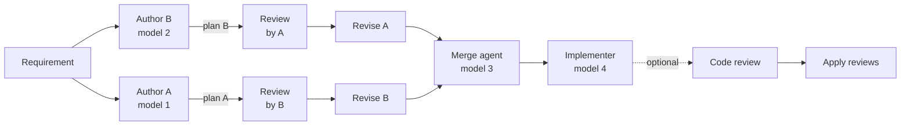

# Workflows

A workflow runs one piece of work through several agents, each on the provider, model and
reasoning effort you pick for its slot. F5 creates a thread for every stage, so you can open any
step and read exactly what that agent did.

## How to

1. Click **New workflow** in the sidebar or on Home, or press `mod+shift+n`.
2. Pick a type: **Feature**, **Code Review**, **Investigation** or **Document**.
3. Describe the work. Attached files are added to the prompt as paths.
4. Under **Models**, choose a provider, model and reasoning effort for each slot.
5. Open **Options** if needed, then click **Start workflow** (`mod+enter`).

The run belongs to the project selected on Home or in the sidebar, and F5 generates its title.

## The four types

| Type          | Stages                                                                                       | Slots                                     |
| ------------- | -------------------------------------------------------------------------------------------- | ----------------------------------------- |
| Feature       | Two competing plans, cross-reviews, revisions and a merge; implementation when you ask       | Author A, Author B, Merge                 |
| Code Review   | Two independent reviews of a branch or PR, consolidated into one ranked report               | Reviewer A, Reviewer B, Consolidation     |
| Investigation | Two investigations, cross-review, optional self-review, then a synthesis that answers        | Investigator A, Investigator B, Synthesis |
| Document      | Two drafts (RFC, ADR, PRD, runbook and more), reviews, a merge and an optional reader review | Author A, Author B, Merge, Reader         |

## Implement a Feature plan

A Feature run stops after the merge; so far only plan files in the plans directory exist. Read the
merged plan, then click **Implement**. Choose the implementation model, **Local** or **New
worktree**, the [access mode](../runtime-modes.md), and optionally **Code review after
implementation**, which adds reviewers and an apply-reviews pass.

[Upstream ports](upstream-ports.md) can also chain a Code Review workflow after opening a PR,
then queue one revision with its consolidated feedback.

## Read results

The phase board shows every stage, its model and status; click a card to open its thread. Below
it is the merged plan, consolidated review, answer or document. **Run inspector** at the bottom
shows the template, cost and per-step context.

## Good to know

> [!WARNING]
> If F5 can't confirm that a stage's turn reached the provider, **Retry** asks first in **Retry may
> duplicate a provider turn**. Choose **Retry anyway** only if duplicate work is acceptable.

- **Retry failed** reruns failed stages; on a Code Review, **Retry merge** reruns consolidation.
- Document authors, and the two investigators, must use different provider and model pairs.
  Feature authors may share one.
- Muse Code can't run stages that need Plan mode or read-only turns.
- Read-only stages can look at the preview browser but can't save screenshots.

Options

- **Own-model review:** each author or investigator also reviews its own output.
- **Plans directory:** where plan and draft files are written (default `plans/`).
- **Compare against branch:** the branch a Code Review inspects; Investigations can compare too.
- **Run cost limit in USD:** checked before each later stage; no new stages start once reached.
- **Reader review of the final document** (Document): a separate reader model critiques the
  result, with an optional persona.

## Archive and restore

Archiving a workflow archives its threads, stops their agent sessions, and pauses queued work.
Restore the workflow from Archive to restore the threads it archived; threads archived separately
stay archived. Restoring does not automatically restart interrupted turns or resume paused queues.
Pending workflow stages can continue from completed results after restoration; interrupted stages
remain available for an explicit retry.
An archived workflow's clean, unused worktrees can be reclaimed through Storage settings.
Threads belonging to active or archived workflows remain protected from permanent storage
purging until the workflow or its project is deleted.

## Related

- [Threads and workspaces](threads-and-workspaces.md)
- [Runtime modes](../runtime-modes.md) (modes per provider)
- [Usage and limits](usage-limits.md) (workflow cost)
