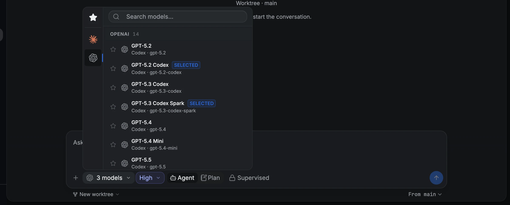
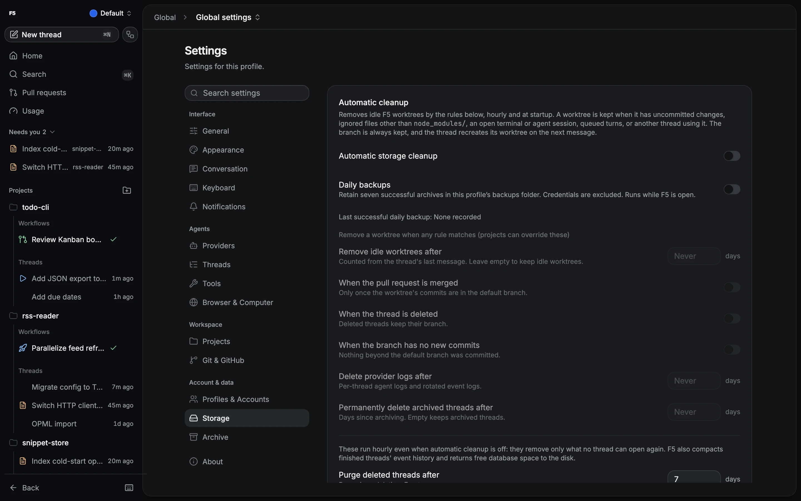

# Worktrees, fan-out and storage automation

Run threads in their own Git worktrees, send one message to several models at once, and let F5
clean up idle worktrees and keep backups.

## How to

1. Start a new thread in a project that is a Git repository.
2. To work in one isolated checkout, open the workspace picker under the composer (it reads
   **Local · <branch>**) and pick a branch under **New worktree from**. Nothing is created
   until you send.
3. To send to several models, Shift+click (or Shift+Enter) up to six models in the model picker
   instead. A plain click goes back to a single model.
4. Send. With several models, F5 creates one thread per model, each with its own worktree and
   branch, whatever the workspace switch says.
5. Follow the setup card above the composer until the agent starts.

## Worktree setup

The first message is queued immediately while F5 prepares the worktree in the background. The
setup card shows each stage: fetching the base branch, checking out files, initializing
submodules, running the project setup script and starting the agent. The message goes out once
checkout and submodules are ready. Setup scripts run in the background unless you enable **Agent
waits**; a failed script is reported on the card and the agent still starts.

From the card you can **Cancel**, **Retry** after a failure, **Work locally** to send the message
in the project root instead, or **Discard** a failed setup to get your message back as a draft.

## Automatic cleanup

**Settings → Storage → Automatic cleanup** (off by default) removes idle worktrees F5 created and
old provider logs. Enable the rules you want: idle for some number of days, PR merged, thread
deleted, or no commits beyond the default branch. **Preview what would run** shows each match and
the action F5 would take or why it would skip it. **Recent activity** shows what ran.

## Removing worktrees and missing checkouts

Deleting conversations opens one removal dialog for their worktrees. Unsafe rows are disabled, and
**Keep all** leaves every checkout in place. Branch deletion is optional and preselected only for
merged branches.

Manual removal lists every ignored file and folder, including build outputs and local configuration.
This deliberately includes `node_modules/`: manual removal requires confirmation even when that is
the only ignored folder. Confirm each checkout separately, including in bulk conversation deletion.
Check **Also delete the ignored files and folders listed above** to include them in removal.
Deleting a listed folder deletes everything inside it. If a removal recheck finds another ignored
path, the dialog refreshes the list and requires confirmation again. An incomplete list blocks removal.

If a thread's worktree goes missing, F5 never quietly moves the thread into the project checkout.
Use **Recreate now** (the branch still exists), **Recreate from the default branch** (it doesn't),
or **Continue in Local** (the project folder). The thread header offers the same choices:
**Recreate worktree**, with **Recreate from `<default branch>`** and **Continue in Local** in its
menu. An archived thread's header shows **Worktree removed** instead; unarchive the thread to
recreate it. A recorded folder that no longer belongs to this repository is kept untouched, and
the thread waits until you choose another workspace.

A thread follows its folder, not a branch. When the agent runs `git checkout`, a rebase leaves a
detached HEAD, or you switch branches in a terminal, nothing is blocked and nothing asks: the next
message is sent, the workspace picker shows the branch the folder is on now (or
`<branch> · detached`), and the timeline notes "Now on `<branch>` (was `<branch>`)". A switch made
during a turn is recorded once, when the turn ends. Local threads follow the project folder the
same way when their own turn starts or ends. To go back, use **Switch branch here…** in the
picker. The branch a thread last saw is what a removed worktree is recreated from.

## Auto-pull and backups

**Settings → Git & GitHub → Auto-pull default branches** fast-forwards clean project roots with `git pull --ff-only`. It
never merges or rebases. **Export backup** writes a consistent snapshot of settings, threads and
attachments while you keep working. **Daily backups** keeps the seven newest scheduled archives.
Restoring a backup takes effect on restart.

## Good to know

> [!NOTE]
> F5 never removes a worktree that has uncommitted or untracked files, initialized submodules,
> an open terminal or provider session, queued turns,
> or an active turn in another conversation using it. Automatic cleanup always keeps the branch,
> so the next message recreates the worktree. Automatic cleanup removes ignored files only when
> they are well-known build or cache output such as `node_modules/`, `dist/` or `.turbo/`. Any
> other ignored file, such as `.env`, `.envrc`, a private key or a local database, keeps the
> worktree; deleting it requires confirmation through manual removal.

- Cleanup and auto-pull can be set per project, but never from a checked-in `f5.json`.
- If F5 restarts mid-setup, the setup shows as failed and nothing is removed.
- Backups leave out credentials unless you choose encrypted credential export and set a password.
- In a fan-out send, threads that fail to start can be retried from the kept draft.

Details and limits

| Topic               | Detail                                                                                                                                                                                                                                                                                                                                                                                                                       |
| ------------------- | ---------------------------------------------------------------------------------------------------------------------------------------------------------------------------------------------------------------------------------------------------------------------------------------------------------------------------------------------------------------------------------------------------------------------------- |
| Fan-out             | Up to 6 models; threads start 3 at a time; attachments are copied to each thread                                                                                                                                                                                                                                                                                                                                             |
| Cancel during setup | A checkout is removed only if its receipt proves F5 created it, its base commit and files are unchanged and nothing else uses it; generated `.env` files and databases keep it. The message stays queued and paused                                                                                                                                                                                                          |
| Cleanup schedule    | Hourly, at startup, after a thread is deleted and when settings change                                                                                                                                                                                                                                                                                                                                                       |
| Cleanup scope       | Only worktrees inside this profile's worktrees directory; never a directory containing a project root. Unreadable identity, claims, locked registrations and in-progress Git operations also block removal. Idle and archived conversations may stay linked and recreate the checkout on their next send. Checks repeat right before removal, and removal never forces                                                       |
| Provider logs       | Removed after the configured number of days; the live event log is never removed                                                                                                                                                                                                                                                                                                                                             |
| Recent activity     | Kept for 90 days                                                                                                                                                                                                                                                                                                                                                                                                             |
| Preview artifacts   | **Keep preview screenshots and recordings for** defaults to 7 days. Profiles share the folder, so the longest setting wins                                                                                                                                                                                                                                                                                                   |
| Auto-pull           | Every 15 minutes. Needs the default branch checked out with an upstream, a clean tree with no untracked files, no merge/rebase/cherry-pick/revert/bisect, no unpushed commits, and no active conversation, queued work, live agent session or live terminal in the root checkout. Fetches before taking locks, then rechecks and fast-forwards to the inspected commit. Skipped while another profile updates the repository |
| Daily backups       | Checks hourly from 1 minute after launch and exports when no scheduled backup succeeded in 24 hours. Archives go to `<profile state>/backups`. Manual and failed exports don't count. Scheduled backups never include credentials                                                                                                                                                                                            |
| Export              | Runs in a separate process that you can cancel. The SQLite snapshot is integrity-checked. Credential-free exports redact OpenCode passwords and sensitive provider variables                                                                                                                                                                                                                                                 |
| Restore             | Into a different state directory, attachment paths are rebound to the new location; ownership and hashes are kept                                                                                                                                                                                                                                                                                                            |

**Manual removal.** Removal rechecks HEAD and usage under locks, and a changed checkout is kept with
a reason. A fully pushed branch can also be selected for deletion, but a deleted upstream alone
never makes unmerged commits safe. Default branches, branches checked out elsewhere and branches
referenced by other conversations can't be deleted. An open provider session blocks removal, even
between turns; stop it first. Initialized submodules block removal: save their work and
deinitialize them first.

**Recovery.** Recovery stops an idle provider session, applies the project's submodule setting and
starts its opted-in setup script, then releases queued work. Setup preparation has a 10-minute
timeout and a **Cancel preparation** action. A failed or interrupted recovery keeps its retry
controls visible.

**Names and paths.** New worktrees live at
`<repository-slug>-<repository-hash>/<branch-slug>-<branch-hash>` in the profile's worktrees
directory, so `fix/login` and `fix-login` never collide; existing worktrees keep their paths and
occupied targets are rejected. Automatic branch names are generated while the base is fetched; a
name ready within 3 seconds names both branch and directory, and a later one may rename only the
branch. Explicit names must be valid, unused branch names outside F5's temporary-name pattern.
Each model in a multi-model send gets its own allocation.

**Preparation receipts.** F5 records preparation in the profile database before creating a
checkout, so a repeated request reuses its receipt and completed preparation never runs twice.
Recreating a missing checkout initializes submodules and runs the opted-in setup script unless
setup was explicitly skipped; checkouts older than receipts are never prepared again
automatically. A restart during a setup script leaves preparation indeterminate, and **Retry**
asks you to confirm rerunning the script. A changed checkout, repository identity or conflicting
request is kept for inspection.

**Kept on disk.** Cancel and rollback keep checkouts with ignored files created by setup (such as
`.env` or a local database) and report them as retained artifacts. Legacy worktrees with
unresolved Git metadata, and legacy setups without a verified checkout commit, are skipped and
never deleted recursively. Paths are preserved exactly, including whitespace.

## Durable workspace switching

Changing an established conversation's workspace stops its idle provider session before
switching. Active or pending turns, queued work, native operations, and setup owners block
switching. A paused missing-worktree message can still use recovery. While a switch is
running, queue resume, promotion, setup retry, and reconnect cannot bypass it; once it ends,
nothing is held. Manual pauses remain paused after switching.

A project's workspace root cannot be changed while it has any non-deleted conversations,
including archived ones. That root is the effective workspace of local conversations; changing
it would silently move those conversations outside their transition checks. Add the moved
repository as a separate project instead. Local PR checkout also preserves an existing branch
when its commit differs from the PR head, even with a clean working tree: clean files do not
prove that local commits are disposable. Use a separate worktree to keep both histories.

Only the current project checkout and registered, attached-branch worktrees inside the
current profile's managed root can be attached. Other profiles' managed checkouts and
external or detached checkouts cannot be attached. Conversations that share a checkout see the
same files and uncommitted changes. In the workspace picker, each checkout's row says how many
conversations already use it, and picking the row is the confirmation.

Changing a branch in place is blocked only by live use: another conversation's running or
pending turn, queued work, worktree setup or workspace transition, an agent session that is
starting or running, an open terminal (yours included), or another profile's reference. Idle and
archived conversations never block it, in the project folder or in a worktree: they follow
whatever branch their folder is on. A new turn waits for a switch that is already under way and
then starts on the new branch. A refused switch names the conversations and what they are doing;
use a separate worktree instead.

A switch that fails, is cancelled, or is cut off by a restart settles itself: there is nothing
to inspect or resolve, and sending is never blocked afterwards. The conversation is always in
either its old workspace or the new one, and no files are restored or discarded.

| Switch                                    | How it settles                                                                                                                                                                                   |
| ----------------------------------------- | ------------------------------------------------------------------------------------------------------------------------------------------------------------------------------------------------ |
| To another worktree or the project folder | The conversation moved only if the switch was recorded; otherwise it stays where it was                                                                                                          |
| To another branch in place                | The folder is the same either way. If Git reached the branch, the conversation records it; if not, it keeps following whatever branch the folder is on                                           |
| Restoring a missing worktree              | If the worktree is back, the conversation uses it, even when a later step such as setup failed. If it is not, the next message restores it                                                       |
| Moving to a new worktree                  | Rolled back as described under [Move a local conversation to a worktree](#move-a-local-conversation-to-a-worktree); a copy that cannot be proven disposable is kept and named, and holds nothing |

When a switch ends unfinished, the action that started it reports the reason, and a switch
that was cut off, or that had to keep a folder, leaves a note in the conversation's timeline.
Start the switch again whenever you like. Archiving or deleting the conversation cancels its
switch and keeps checkout files.

## Manage worktrees

Open **Worktrees** beside Usage in the sidebar, search for **Open worktrees** in the
command palette, or choose **Worktrees…** in a project's context menu. Storage settings
also links to this page through **Manage worktrees**. Filter by project or search a branch,
full path, or linked conversation. The project checkout appears first, followed by
referenced and unreferenced checkouts. **Refresh** rechecks local state; there is no polling.
Unreadable projects report an error, and an unavailable status is shown as unknown.
Projects opened at a subfolder of a Git checkout report its checkout root instead of
offering an attachment to that subfolder. Add the checkout root as a project to manage its worktrees.

Rows show missing directories, local changes, locked registrations, and detached HEADs.
Choose **Inspect** for current removal blockers and branch deletion eligibility. **Remove…**
opens the same guarded dialog used for thread deletion. Missing managed checkouts offer
**Remove stale entry**. Project checkouts cannot be removed. External, other-profile, and
detached checkouts are inspect-only; paths can still be copied, revealed, or opened in an editor.

Use **New conversation here** to attach a new draft to an eligible checkout. Select an
existing conversation and choose **Use for this conversation** to switch it through the durable
workspace transition. Each row lists the conversations that already use the checkout; they will
see the same files and uncommitted changes, and choosing the row acknowledges that without a
confirmation dialog. New local conversations already share the project checkout. The server rechecks eligibility when attaching or switching,
so a list entry never grants permission to mutate a checkout.

## The workspace picker

One picker under the composer chooses where a conversation works. Its label says where that is:
**Local · main** for the project folder, **New worktree · from main** for a worktree created at
send, the branch name inside an existing worktree, and **· missing** when that worktree's
directory is gone. The workspace and branch keyboard commands both open it.

The top of the picker shows the current path, with buttons to copy it, open it in an editor,
reveal it, or open a terminal there. The list below has these groups:

- **Project folder**: work in the project folder on its current branch. The row shows how many
  conversations already work there.
- **New worktree from** (new conversations only): the default branch first, then local and
  remote-only branches that no worktree has checked out. Picking one selects the base; the
  worktree and its branch are created when you send.
- **Open worktrees**: join a worktree that already exists. The row shows how many conversations
  already use it.
- **Manage**: **Switch branch here…**, **Move to a new worktree…**, **Manage worktrees…**,
  **Discard originals from move…** and **Remove worktree…**, where they apply.

Type to filter. A pull request reference offers **Checkout Pull Request**. In a new
conversation, a name with no matching branch offers **New worktree on new branch "name"**,
which keeps the selected base (the default branch if none).

**Switch branch here…** lists the branches this checkout can switch to, plus **Create branch
"name" here**. When live use blocks the switch, the rows are disabled and the picker names the
conversations that are using the checkout and what they are doing. If Git reports files that
the switch would overwrite, a new conversation can start in a new worktree instead.

While a new conversation is set to a new worktree, the bottom of the picker has a **Branch
name** field (leave it empty for an automatic name) and, when the project has an opted-in setup
script, **Run setup script**. The new worktree starts from committed contents of the base
branch; uncommitted edits stay where they are. Both choices persist with the draft.
Multi-model sends generate independent names; explicit naming is disabled for them. Invalid or
occupied branch names are rejected by the server before creating a conversation, keeping the
draft available for correction.

## Related

- [Project settings](project-settings.md)
- [Codex marketplace cleanup](../providers/codex.md#good-to-know)
- [Getting started](getting-started.md)

## Reviewing and reclaiming storage

Settings → Storage opens immediately while F5 measures the current profile. The last
measurement remains visible during updates and after restart. Rescan joins an existing
scan; repeated clicks do not start competing directory walks. A report from an earlier
backend or from before a cleanup must be refreshed before it can authorize deletion.

The overview separates worktrees, provider homes, database files, logs, attachments,
legacy data, and other state. Reclaimable space counts each file once; individual cleanup
categories can overlap. Sizes use allocated filesystem blocks where available; compressed
files and APFS clones remain estimates. Deleting database rows alone does not reclaim
database file bytes. Compaction runs in a separate process: F5 stays responsive while
conversations wait for the database connection.
An independent lifetime watchdog terminates the helper if its backend exits, including
while SQLite is doing synchronous work. Completed cleanup results remain available if
optional compaction fails or is cancelled.

Expand a cleanup category to inspect targets, select individual threads, files or worktrees,
and copy their paths. Orphan attachments are never selected by default. Provider homes
are shown for inspection only; manage their sessions, transcripts and caches from the
provider CLI. Purged threads cannot be restored from Archive. Busy or blocked archived
threads stay in Archive; failures after deletion remain retryable deleted-thread candidates.
Unreadable provider homes show unavailable usage without preventing cleanup of accessible
categories. Refused attachment removals retain their registry entry until a confirmed retry
successfully removes the file, or confirms it is absent.

**Repositories and worktrees** also lists `node_modules`, `.turbo` and Python `.venv` folders
in every known checkout, and Git downloads that were interrupted more than a day ago. Dependency
folders are never selected by default, and a checkout's folders are blocked while an agent works
there or a thread used it in the last 24 hours; reinstall them with the restore command shown on
each target. Folders that contain a Git checkout are never offered. A project folder that is not
itself a repository, such as a folder of clones, is searched for repositories automatically and
appears under **From projects** in Storage discovery; turn this off there, and note that your home
folder and the folders above it are never searched this way.

With machine cache scanning on, Storage also offers the devbox warmup cache, Playwright browsers,
the Electron and node-gyp download caches, Claude plugin trash in `~/.claude`, and unused Docker
images (`docker image prune --all`; containers, volumes and build cache are kept, but locally
built images without a registry copy are lost). Docker images are only offered when Docker runs
on this machine. F5's own updater downloads and plugin trash in F5's Claude home are always
offered once they are a day old.

Automatic database compaction waits for a quiet moment. If it has been skipped for three days,
the Database section shows how much space is stuck and offers **Compact now** or **Compact on
next restart**, which compacts as soon as F5 has finished starting. Either way agents pause until
it finishes; a scheduled compaction shows its progress in Storage and can be cancelled there.
Both need room for a temporary copy of the database and stay disabled until enough disk space is
free.

Cleanup belongs to the profile backend and continues if its window disconnects or you
leave Settings. Progress and results reappear on reconnect. Cancel stops before the next
target; an irreversible thread cleanup finishes its current target. After a backend restart,
rescan and confirm again. **Review remaining work** creates a fresh review and never replays
a previous destructive request. Activity includes manual and automatic cleanup and can be
filtered by source. Backup audit rows are history and never resume cleanup after restore.

## Move a local conversation to a worktree

For an existing local conversation, open the workspace picker and choose **Move to a new
worktree…**. Finish the active turn and remove queued work first. You can supply a
new branch name or let F5 generate one from the first user message.

The dialog shows the project checkout's changed-file count. Moving copies all its
uncommitted tracked, staged, and untracked changes, including edits made outside the
conversation. Staged changes stay staged. Executable modes and symlinks are preserved.
The project checkout is left unchanged, and existing Git stashes are untouched.
Ignored files such as `.env` are excluded. The next send prepares the new checkout,
including the project's submodule policy and opted-in setup script.

Moves require a committed HEAD and no Git operation in progress. Commit or stash dirty
submodule changes first. Untracked files are limited to 5,000 files and 500 MiB in total.
Sending and competing workspace actions remain blocked by the durable transition while
F5 stops an idle provider session, snapshots changes, and copies the checkout.

After moving, **Discard originals…** in the success notification, or **Discard originals
from move…** in the worktree menu, saves the originals in a reversible Git stash with a
message identifying the branch and move. A confirmation names that stash and any other
loaded conversations sharing the project checkout. F5 refuses if the original checkout has changed,
or a live session, terminal, queued operation, conflicting transition, or another profile
references it. Restore
that stash manually if you want the originals back. A failed discard can be retried only when the source snapshot and stash ref are both
verified unchanged. An interrupted or ambiguous discard requires manual inspection of the
project checkout and stash list.

An interrupted move whose workspace transaction committed is completed on restart.
Otherwise F5 rolls it back while leaving the source untouched. Only verified copies in
an owned checkout at the unchanged base commit can be cleaned up. Unexpected files,
ignored secrets, changed commits, or new references retain the checkout and branch with
an explanation. The temporary private `refs/f5/moves/<operationId>` ref is removed after
completion, rollback, or cancellation; it never uses `refs/stash`. Archiving or deleting
a conversation cancels the worker, waits for filesystem writes to settle, releases the
private ref, and records any retained checkout and branch. A retained checkout is named in the
conversation's timeline and listed on the Worktrees page; it never blocks sending or another
move. Untracked nested repositories must be committed, ignored, or removed before moving.

## Settlement scripts and cleanup

**When the thread is settled** is a separate cleanup rule and starts off. It uses
the same checkout, queue, session, process and environment-file safety checks as
other automatic cleanup rules and retains the branch. Like the other rules, it
removes ignored build and cache output but keeps the worktree when it holds any
other ignored file, such as a database, `.envrc` or a private key.

A project script's **Run when worktree settles** option also starts off. Enabled
scripts run sequentially in that linked worktree before cleanup can remove it.
The runner owns each process, limits a script to two minutes and the job to five,
and captures at most 20 scripts in a 64 KiB snapshot. A failure adds a notice and
allows cleanup to continue through its safety checks. Waking or archiving the
thread cancels its owned job and waits for process exit before releasing the
worktree claim. A server restart never replays an already-running script. Its
unverified process claim keeps the checkout protected and a notice explains why.
